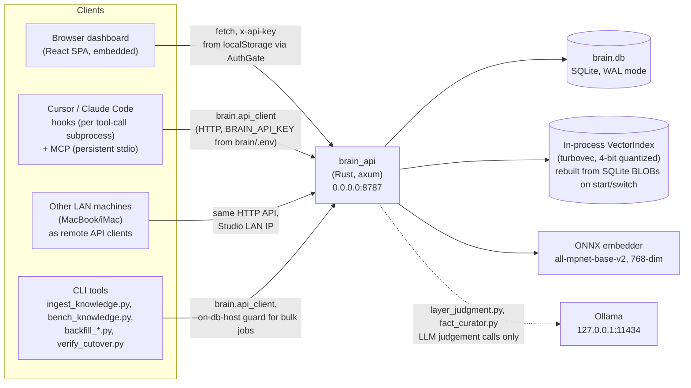
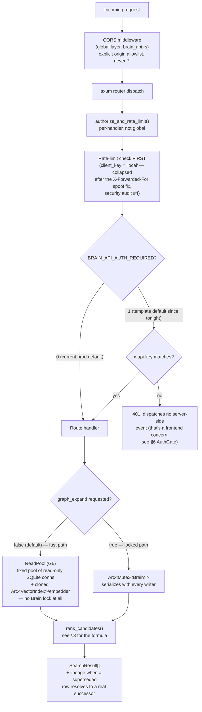
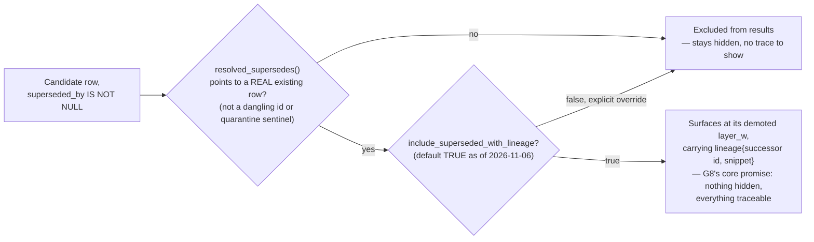
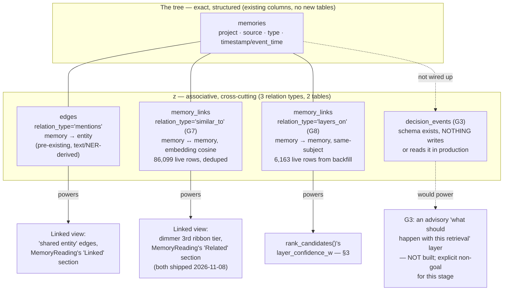
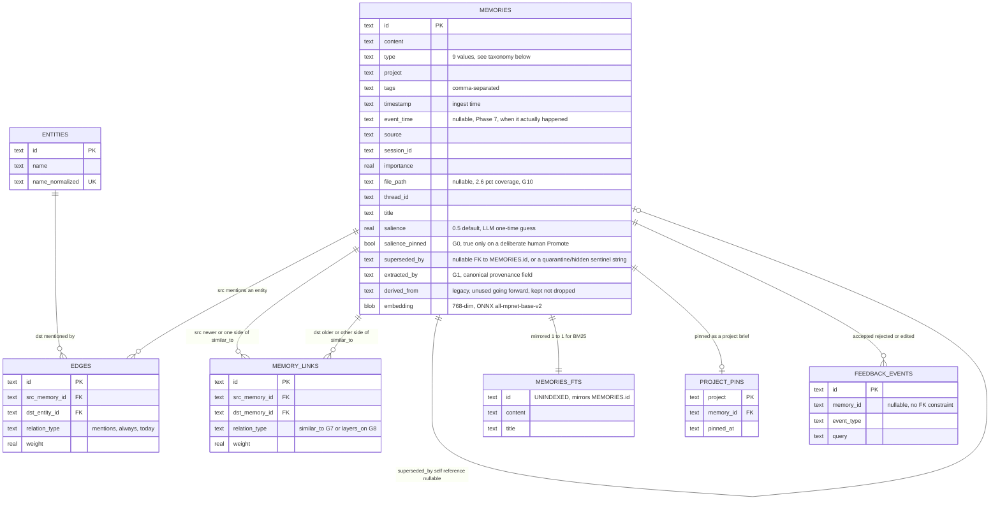
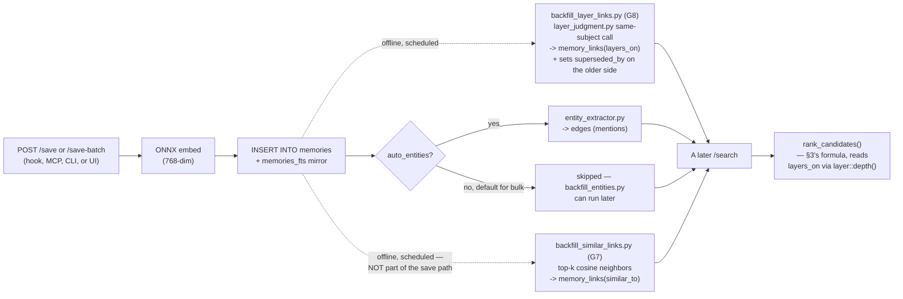
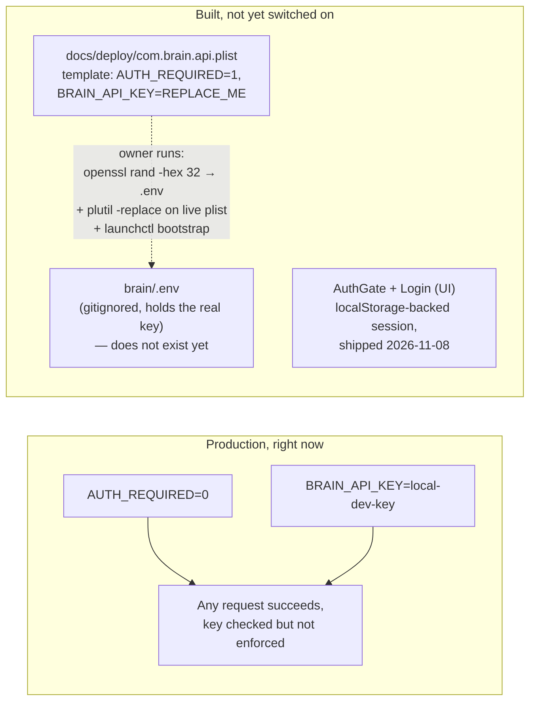
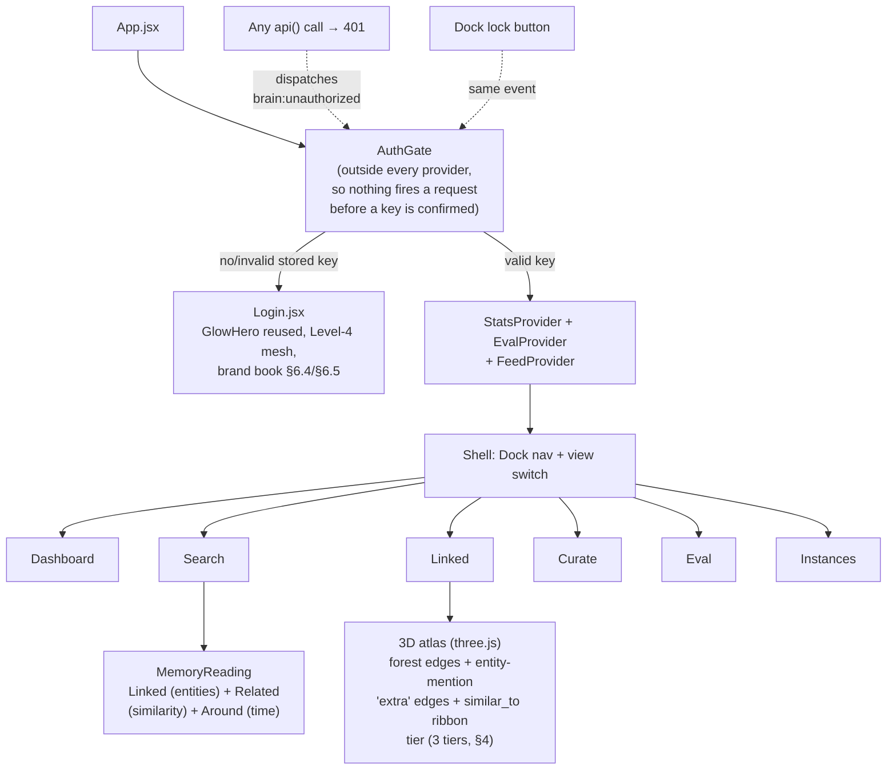
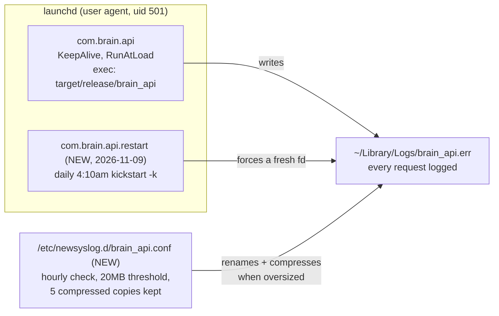

# Brain — Current Architecture (2026-11-09)

**What this is:** a snapshot of the system as actually deployed and verified against code, not a design intent. Every claim below was checked against `brain.rs`/`brain_api.rs`/`store.rs`/`types.rs`/the UI source at **HEAD `90ad94c`** on 2026-11-09 — grep'd and read, not recalled. Where something is only partly true (shipped in code but not yet surfaced, or shipped but off by default), that's called out explicitly rather than smoothed over.

**Companion docs, not duplicated here:** `docs/architecture/cognitive-architecture-spec.md` (the formal model and the G0–G10 gate history — *why* each piece exists), `docs/architecture/cognitive-architecture-diagram.md` (the temporal-layer node model specifically), `docs/SECURITY_AUDIT_2026-11-05.md` (the security findings this architecture's auth/CORS layer closes), `docs/CHANGELOG-SHARED-CODE-BRAIN.md` (commit-by-commit history). `docs/architecture/system-diagrams.md` is **not current** — it describes a pre-Rust-cutover, ChromaDB-era topology and a "native Rust MCP" that isn't what's deployed (the MCP server is Python stdio, `brain/mcp/server.py`); kept as-is per this repo's own rule against rewriting historical records, but don't read it as today's state.

---

## 1. System context

Who talks to `brain_api`, and how.



**Why the LAN binding (`0.0.0.0:8787`) is not a bug:** this Mac Studio is the single host; other machines on the same LAN are meant to reach it as remote clients (confirmed deliberate, 2026-11-08). The security boundary is auth (§5), not network isolation.

---

## 2. Request pipeline

Every request's path from socket to response. Two real forks: **fast path vs. locked path** (performance, G6), and **auth-required vs. not** (currently off in production — see §5).



**Writes** (`/save`, `/save-batch`, `/memories/:id` PATCH, instance mutations) always take the `Arc<Mutex<Brain>>` path — only reads got a lock-free fast path (G6's own scope, verified: profiling showed CPU climbing to 500–800% under concurrent load once the lock was removed from the read side; absolute throughput ceiling past that point is ONNX embedding inference cost, not lock contention — a different, accepted limit).

---

## 3. The ranking formula — what "cognitive" actually means in code

This is the heart of the system: not a single relevance score, but several independent modulators multiplied together, most of them gated behind an explicit decision (a "G" gate) about whether they're trustworthy enough to apply by default.

```
final_score = source_quality_w  ×  salience_w  ×  layer_confidence_w  ×  recency_w  ×  hybrid_score  ×  knowledge_w
```

| Term | Formula | Default | Gate | What it means |
|---|---|---|---|---|
| `hybrid_score` | `α·cos_norm + (1-α)·bm25_norm` | always applied | — | The base relevance signal: blended vector similarity + keyword rank. Everything else *modulates* this, none of it substitutes for it. |
| `recency_w` | `0.85 + 0.15 · 0.5^(age_days/730)` | always applied | — | 2-year half-life, floor 0.85 — age alone never suppresses a result by more than 15%. |
| `salience_w` | `clamp(1 + 0.3·(salience-0.5), 0.85, 1.15)` **only if `salience_pinned`** | on, but only affects ~19 pinned rows | **G0** | The LLM's own one-time quality guess was found to *anti-correlate* with real quality (Phase 6 calibration) — so it's excluded from ranking except for a human's deliberate "Promote" in the UI. |
| `layer_confidence_w` | `layer_w(depth(m))`, bounded `[0.85, 1.0]` | **on by default** | **G8** | Replaces the old blanket `salience_w` for the ~99% of rows that were never pinned. `depth(m)` = how many newer memories about the *same subject* sit on top of this one (via `layer_judgment.py`'s LLM same-subject classifier, F1 0.851). The deeper buried, the more demoted — but never below the floor. |
| `source_quality_w` | fixed per `source` enum (Obsidian 1.15, Perplexity 1.0, session/hook sources 0.85) | **computed always, applied only if the request opts in** | G2 | Shipped but deliberately not live in default ranking — an A/B on the one gold set available was inconclusive (93.7% of the corpus shares one source tier, nothing to contrast against). |
| `knowledge_w` | `clamp(1 + K_BASE + K_CLOSE_MAX·closeness(distance) [+ K_PROJ if same-project], 1.0, cap)` | on, `knowledge`-type rows only | — | A small, hard-capped proximity bonus so deliberately-ingested reference material (`ingest_knowledge.py`) can win a close match without overwhelming everything else. |

**The gate that decides whether a result *appears at all*, separate from scoring:**



This is the one piece of the vision most worth naming precisely: **a superseded memory is never silently gone.** It's demoted, not deleted, and the row that replaced it is attached as `lineage` — though as of today that `lineage` field is **not rendered anywhere in the UI** (verified: zero references to `lineage`/`layer_w`/confidence in the frontend). The reasoning is real and live in the ranking engine; it isn't yet visible to a person using the dashboard. That gap is tracked, not accidental — see the closing note.

---

## 4. The cognitive/temporal-layer data model

The "tree + associative links" hybrid the owner's own notation describes (`cognitive-architecture-spec.md` §8.1), as it actually exists in SQLite today:



**What's genuinely new since the last architecture review (this week):** the `similar_to` edges existed in storage for months but had no consumer anywhere — a completely invisible half of the "hybrid system" the vision describes. As of 2026-11-08 they're drawn in the graph and listed in the reading pane. `layers_on` edges, by contrast, never surface as *edges* anywhere visually — they only act invisibly, inside the ranking formula (§3).

**G4, the gate not yet open:** none of these link types currently expand or re-rank a query's results (`graph_expand` only ever walks `edges`, and even that is opt-in, off by default). Using `similar_to` or `layers_on` to actually *change what a search returns* — not just what you can browse to afterward — requires a gold-eval pass that hasn't been run.

---

## 5. Memory architecture — the `Memory` entity and its relations

§4 showed the *conceptual* tree+links model. This is the literal schema underneath it — every table a `Memory` actually touches, read straight from `store.rs`'s `CREATE TABLE` statements, not inferred.



**Deliberately not folded together, on purpose:** `edges` (memory to **entity**) and `memory_links` (memory to **memory**) look similar but were kept as two tables specifically so neither target type's column gets overloaded the way `superseded_by` already was once (it carries both a real predecessor id *and* `quarantine:*`/`hidden:*` sentinel strings — a known, accepted overload, not a new one to repeat). `memory_links.relation_type` already carries two unrelated shapes (`similar_to` is symmetric/undirected in practice, `layers_on` is directed newer→older) in the same table by design, per spec §7.2's note that a third relation type can join later without conflating either existing shape.

**Operational/audit tables that reference memories loosely (by id string, no FK, often nullable) but aren't part of the entity graph itself:** `curation_events` (`fact_id`, every curator ADD/MERGE/IGNORE/UPDATE decision), `backfill_batches` (`p1_before`/`p1_after` — the regression gate, G5), `decision_events` (`retrieved_memory_ids` as a JSON array — G3, currently written by nothing), `memory_atlas_positions` (cached 3D layout coordinates per `(run_id, point_kind, point_id)`, rebuilt from live data on demand, never a source of truth).

### Memory type taxonomy

Nine `type` values exist; the brand book (§5.6) groups them into seven "signal" roles so two types can share a feel when the icon/word still tell them apart:

| Signal | Types | What it's for |
|---|---|---|
| **Rely** | `fact`, `knowledge` | "You can stand on this" — verified data, or deliberately ingested reference material (`ingest_knowledge.py`, the only sanctioned writer besides explicit saves) |
| **Use** | `decision`, `solution` | A choice or a fix you'd apply again |
| **Notice** | `pattern` | A recurrence worth flagging |
| **Lesson** | `error_lesson` | Something failed and was kept, deliberately, not hidden |
| **Spoken** | `conversation` | Talk — not a status, kept quiet |
| **Frame** | `project_context` | The shelf a memory sits on |
| **Raw** | `episode` | Source tape — a raw tool-call trace, excluded from untyped search by default (`exclude_episodes_by_default`) so it never crowds out curated memory |

### Lifecycle: save → (optional) structure → query-time resolution



No part of this lifecycle deletes a row. `superseded_by` is the only thing that changes an existing memory after it's written, and only ever to point forward at what replaced it — never to remove content, never to rewrite it.

---

## 6. Security and auth



Closed findings (verified against live state, not a commit message, on 2026-11-08): CORS allowlist (no wildcard, RFC1918-LAN-aware), rate-limit bucket-spoofing fix (collapsed to one shared key instead of trusting `X-Forwarded-For`), every committed placeholder key scrubbed from the public repo, the AGENTS.md LAN IP redacted, `.claude/settings.local.json`'s overly-broad grants narrowed. **Not yet flipped live:** the actual `AUTH_REQUIRED=1` + real key rollout — the code and UI are ready; the live service is intentionally still running open, by the owner's own choice, pending that one manual step (`brain/.env` + `plutil -replace` + a launchd reload — see §1 for why I can't do this step myself: the sandbox blocks an agent from both generating *and* reading back real credential material, by design).

---

## 7. Frontend



Six views exist (`Dock.jsx`'s `VIEWS`); no new destinations added by this week's work. The brand book's "no new destinations in this pass" rule (§10) still holds — Login isn't a seventh *view*, it's a gate in front of all of them.

---

## 8. Deployment and ops



`brain_api` has no SIGHUP-reopen support for its log file, so rotation alone would silently stop working after the first rotation (the process keeps writing into the renamed-away file). The daily restart closes that gap — both pieces were missing until 2026-11-09; the log had grown unbounded to 18MB+ before this was noticed and fixed.

---

## What this diagram deliberately does *not* claim

- It does not claim the dashboard *shows* the cognitive reasoning behind a ranking (§3's closing note) — the engine and the product experience are at different levels of completion.
- It does not include G3 (decision-event router / advisory routing) as a working system, because it isn't one — schema only, explicitly out of scope for this stage.
- It does not claim `similar_to`/`layers_on` edges influence *what* gets retrieved, only what gets *shown alongside* a retrieval or *how it's scored once already retrieved* — G4 (ranking/expansion use of new edge types) remains ungated.

**Verified against:** `git log -1` → `90ad94c`, 2026-11-09. Re-verify before trusting exact numbers (edge counts, test counts) against a later HEAD — they drift fast in this project, which is the whole reason this file exists instead of relying on memory.
