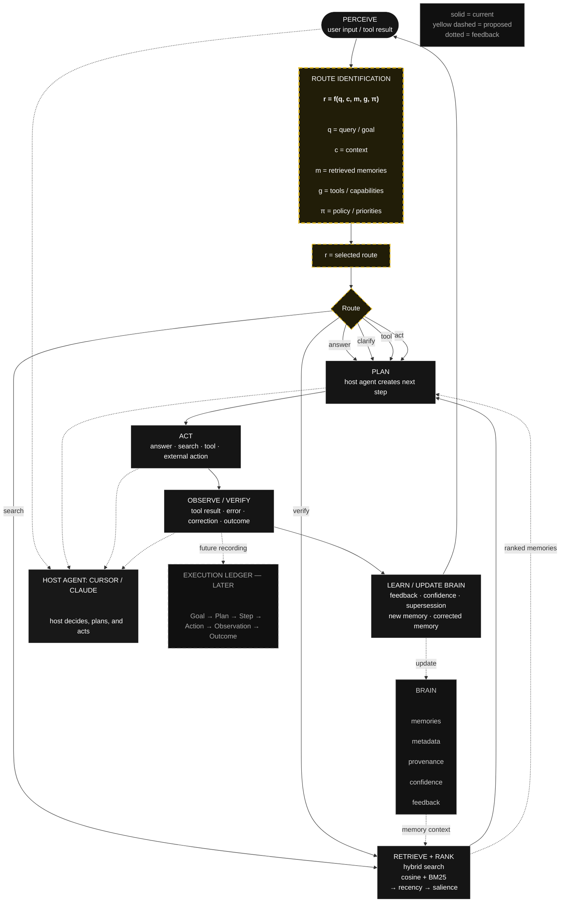

# I designed this for brain, what do u think?

I think it’s a strong **first visual model for an AI agent’s “brain”**—you’re separating cognition into memory, reasoning, projects, dates, types, confidence, links, and sources. The graph structure communicates that the agent should not just store facts, but connect them into context.

## What works

- **Clear symbolic vocabulary:** $a$ = agent, $m$ = memory, $n$ = brain, $x$ = project, $y$ = date, $t$ = type, $c$ = confidence, $z$ = links, and $s$ = source.
- **Hierarchical structure:** Agent → brain → project/date branches gives you a useful starting ontology.
- **Source and confidence nodes:** These are especially important because they let the system distinguish “what it knows” from “how reliable that knowledge is.”
- **The question “how to identify the route it needs?”** is the key problem. That suggests your brain is not merely a knowledge graph—it is also a routing and decision system.


## Main improvement

Right now, the diagram mixes several different kinds of things:


| Category | Examples in your diagram |
| :-- | :-- |
| Entities | agent, project, date, source |
| Properties | type, confidence |
| Relationships | links |
| Processes | route identification |
| Storage | memory |

I would separate them visually. For example:

```text
Agent
 └── Brain
      ├── Memory
      │    ├── Entity
      │    ├── Event
      │    ├── Project
      │    └── Document
      ├── Metadata
      │    ├── Type
      │    ├── Timestamp
      │    ├── Confidence
      │    └── Source
      ├── Relations
      │    ├── supports
      │    ├── contradicts
      │    ├── depends_on
      │    └── derived_from
      └── Router
           ├── retrieve
           ├── reason
           ├── verify
           └── act
```

The most important conceptual correction is that **confidence, type, date, and source should probably be attributes or metadata attached to memories**, rather than independent memory nodes—unless you intentionally want every attribute to be queryable as a first-class graph object.

## Route identification

For “how does the brain identify the route it needs?”, I’d define a routing function:

$$
r = f(q, c, m, g, \pi)
$$

Where:

- $q$ = current query or goal.
- $c$ = current context.
- $m$ = retrieved memories.
- $g$ = available tools or capabilities.
- $\pi$ = routing policy or priority rules.
- $r$ = selected route.

A practical route could be:

```text
Input
  ↓
Classify intent
  ↓
Extract entities and constraints
  ↓
Retrieve relevant memories
  ↓
Check confidence and source quality
  ↓
Choose route:
  ├── answer directly
  ├── ask clarification
  ├── search memory
  ├── call external tool
  ├── verify conflicting information
  └── execute an action
  ↓
Store result and update confidence
```


## One important missing piece

You need a distinction between:

- **Memory:** “The user is building a pharmacy platform.”
- **Goal:** “Design the pharmacy platform architecture.”
- **State:** “The authentication module is incomplete.”
- **Plan:** “Implement database schema, then API, then UI.”
- **Action:** “Create the Supabase tables.”
- **Outcome:** “Tables were created successfully.”

Without goals, state, plans, and outcomes, the system may have excellent memory but still lack an actual cognitive loop:

```text
Perceive → Understand → Retrieve → Plan → Act → Observe → Learn
```

I’d add **goal**, **state**, **plan**, and **action** as core node types.

## My suggested next version

```text
                         Agent
                           │
                         Brain
          ┌────────────────┼────────────────┐
       Memory            Router            Executive
          │                │                  │
   ┌──────┼──────┐      Goal → Route      Plan → Action
  Facts  Events Projects     │                  │
   │       │       │       Tools             Outcome
   └───────┴───────┘         │                  │
       Metadata              Verification ──────┘
   source · date · type · confidence
```

Overall, the idea is good. The strongest direction is to evolve it from a **graph of remembered information** into a **memory-plus-routing architecture**: memory tells the agent what it knows, while the router decides what kind of cognition or action is needed next.

<span style="display:none">[^1_1]</span>

<div align="center">⁂</div>

[^1_1]: image.jpeg


---

# Is the router a good choice or would it be better to let the ai agent decide? Maybe with the right soul.md or claude.md the routing wouldnt be so necessary. I may be wrong.

Your instinct is partly right: **the agent should decide the route when the problem is open-ended**, but you should still keep a router layer for safety, efficiency, and control. A good architecture is not “router versus agent”; it is **deterministic boundaries plus agent-driven decisions inside those boundaries**.

## Soul files are not routing

A `soul.md` or `claude.md` can define:

- The agent’s identity and priorities.
- How it should reason.
- Which tools it prefers.
- When it should ask for clarification.
- Its communication style.
- General safety and quality rules.

But a prompt is not a reliable replacement for control flow. The model may interpret “always verify medical information” differently across contexts, forget a rule in a long context, or choose an expensive and unnecessary path. Explicit routing is easier to test, monitor, and enforce.

Anthropic describes routing as useful when inputs fall into distinct categories, while agentic behavior is more appropriate when the model needs flexibility and dynamic tool use. LangChain makes a similar distinction: routers fit clear categories and deterministic classification, whereas supervisors fit conversation-aware orchestration.[^2_1][^2_2]

## Use a hybrid architecture

I would divide responsibility like this:

```text
                    User request
                         │
              ┌──────────┴──────────┐
              │                     │
       Hard safety/policy      Agent supervisor
       and system routing       decides next step
              │                     │
              └──────────┬──────────┘
                         │
                 Selected capability
                         │
        ┌────────────────┼────────────────┐
        │                │                │
     Memory           Search            Code/API
      agent            agent             agent
        │                │                │
        └────────────────┴────────────────┘
                         │
                  Validator/guard
                         │
                    Final response
```

The **router** handles boundaries that must not be left entirely to the model:

- Authentication and permissions.
- Medical, financial, or destructive operations.
- Which tools are available in the current session.
- Cost and latency limits.
- Whether external search is mandatory.
- Whether human approval is required.
- Which specialist context is allowed.

The **agent** handles decisions that require interpretation:

- Which memories are relevant.
- Whether one tool call is enough.
- Whether to search, reason, ask, or act.
- How to recover from an error.
- Whether multiple subtasks should run.
- What to do when the request does not fit a known category.


## Avoid a giant central router

I would not build a router that tries to predict every possible route:

```text
if query == X:
    use agent A
elif query == Y:
    use agent B
...
```

That becomes brittle quickly. Instead, make the router a **small control plane** with only a few decisions:

```text
route = {
  "risk": "low | medium | high",
  "mode": "answer | retrieve | research | execute",
  "domain": "general | code | healthcare | commerce",
  "approval_required": true | false
}
```

Then let the agent operate within those constraints.

For example:

```text
User: "What did I decide about the pharmacy project?"

Router:
  mode = retrieve
  risk = low
  domain = healthcare

Agent:
  search project memory
  compare dates
  answer with source and confidence
```

But:

```text
User: "Delete the pharmacy database."

Router:
  mode = execute
  risk = high
  approval_required = true

Agent:
  explain consequences
  request confirmation
  do not execute yet
```


## The best pattern for your brain

Your diagram could include both:

```text
Brain
├── Memory
├── Context
├── Router
│   ├── Policy gate
│   ├── Risk classifier
│   ├── Capability selector
│   └── Cost/latency gate
├── Executive agent
│   ├── Goal interpretation
│   ├── Planning
│   ├── Tool selection
│   └── Recovery
├── Specialists
└── Validator
```

I would rename “router” internally to **control plane** or **executive gateway**, because “router” can sound like a simple classifier. The router decides what is *allowed and appropriate*; the executive agent decides how to accomplish the task.

## A useful rule

Use this decision rule:


| Situation | Preferred decision-maker |
| :-- | :-- |
| Clear category with a dedicated handler | Code/router |
| Authentication or authorization | Code/router |
| Safety-critical or destructive action | Code/router plus approval |
| Choosing between several memories | Agent |
| Multi-step research | Agent |
| Unexpected or ambiguous request | Agent |
| Cost/model selection | Router |
| Tool failure recovery | Agent, within limits |
| Unknown domain | General agent fallback |

Routing is also valuable for efficiency: recent research on routing between lightweight inference and full agent execution found that sending easy requests to a cheaper path can substantially reduce latency while preserving much of the stronger agent’s performance.[^2_3]

## My recommendation

Start with **one general agent**, not a multi-agent system:

```text
request
  → lightweight policy/router
  → one capable agent
  → memory/tools
  → validator
  → response
```

Give it a strong `soul.md`, but treat that file as **behavioral guidance**, not as the source of truth for permissions or system control.

Then add specialized routes only when your logs show a real problem:

- The agent repeatedly chooses the wrong tool.
- Context becomes too large.
- Certain tasks need different models.
- Safety rules are being violated.
- Costs or latency become excessive.
- A domain requires isolated knowledge.

So your original idea is good, but I would frame it this way:

> **The agent chooses the cognitive path. The router defines the legal, safe, efficient space in which it may choose.**

That gives you autonomy without surrendering control.

<span style="display:none">[^2_10][^2_11][^2_12][^2_13][^2_14][^2_15][^2_4][^2_5][^2_6][^2_7][^2_8][^2_9]</span>

<div align="center">⁂</div>

[^2_1]: https://www.anthropic.com/engineering/building-effective-agents

[^2_2]: https://docs.langchain.com/oss/python/langchain/multi-agent/router

[^2_3]: https://arxiv.org/html/2605.07180v1

[^2_4]: https://resources.anthropic.com/hubfs/Building Effective AI Agents- Architecture Patterns and Implementation Frameworks.pdf

[^2_5]: https://www.anthropic.com/engineering/writing-tools-for-agents

[^2_6]: https://www.anthropic.com/engineering/multi-agent-research-system

[^2_7]: https://blog.naitive.cloud/building-effective-agents/

[^2_8]: https://forum.langchain.com/t/how-to-implement-the-router-pattern-in-deep-agents-routing-to-multiple-specialized-deep-agents-with-different-structured-outputs/3336

[^2_9]: https://shshell.com/blog/deterministic-ai-agents-langchain-langgraph

[^2_10]: https://github.com/dariorlima/langgraph-router

[^2_11]: https://docs.bswen.com/blog/2026-03-20-deterministic-routing-ai-agents/

[^2_12]: https://entelligence.ai/blogs/9-best-llm-routers-and-model-routing-tools-in-2026

[^2_13]: https://github.com/machinedge/building-effective-agents/blob/main/building-effective-agents.md

[^2_14]: https://www.reddit.com/r/ClaudeAI/comments/1hiww4y/i_just_read_anthropics_blog_on_building_effective/

[^2_15]: https://pub.towardsai.net/agent-workflow-patterns-beyond-anthropics-playbook-1bd76a48d63d


---

# this is where brain is today:

**Close on memory. Far on the rest.** The left column of that diagram is already this brain. The router and the executive are not. The host agent (Cursor or Claude) still does route choice, planning, and action. Brain stores and ranks.

Live corpus checked 2026-10-12: **25,271** memories (**15,345** live), **26,753** entities, **69,326** edges.


| Layer in the diagram | Where we are | Distance |
| :-- | :-- | :-- |
| Metadata on a memory (type, date, source, confidence) | Columns on `memories`, used in rank | Close |
| Memory kinds (facts, events, projects, documents) | Types exist; documents empty; projects are a string | Partial |
| Relations (`supports`, `contradicts`, `depends_on`, `derived_from`) | Every edge is `mentions` | Far |
| Router `r = f(q, c, m, g, π)` | One ranker. No route choice | Absent |
| Executive (goal, state, plan, action, outcome) | No such types. `outcome` is a fact tag | Absent |
| Perceive → retrieve → plan → act → learn | Retrieve is real. Plan and act sit outside. Learn is thin | Far on the loop |

## What already matches

The review’s main correction is the current schema. Confidence, type, date, and source are attributes on a memory, not graph nodes.

Each memory row carries `type`, `project`, `timestamp`, `source`, `salience`, `event_time`, `derived_from`, `importance`, `tags`, and `superseded_by`. Search score is hybrid cosine + BM25, then recency, then salience as a small weight (`0.85`–`1.15`), then a knowledge prior. `event_time` is filled on **14,717** rows. `derived_from` is filled on **14,717** rows, and it is an extractor stamp (`openrouter/google/gemini-2.5-flash-lite/v1` on **13,674**), not an edge to a parent memory.

Live types: solution **7,123**, fact **5,053**, conversation **2,197**, project_context **458**, pattern **202**, decision **190**, error_lesson **118**, episode **4**. `knowledge` exists in code and has **0** rows. Fact rows also carry a `fact_type` tag across all **14,979** facts (including quarantined): decision **5,368**, named_entity **5,268**, error_fix **2,660**, outcome **1,190**, preference **231**.

So “outcome” exists as a label on a fact. It is not a node that closes an action.

## Where the distance is

**Relations.** All **69,326** edges are `mentions`: memory → entity. **17,544** entities have degree 1. **100** have degree ≥ 50. Max degree is **803**. There is no `supports`, `contradicts`, or `depends_on`. `parent_id` is **0** on every row, so facts are not linked back to an episode. `superseded_by` is the only “this replaces that” pointer: **1,726** real supersedes, plus **8,200** quarantined as `quarantine:path_fragment_project` (those sit at salience **0.1** and drop out of search). One-hop graph expand stays off. The August 2026 A/B on 150 gold queries lost **5.3** points of hit@10.

**Router.** Nothing in `brain_api` classifies intent, checks source quality, then picks among answer, clarify, search, tool, verify, or act. `q` is the search string. `m` is the ranked list. `c` is an optional `project` filter. `g` (tools) and `π` (policy) live in the host. The jobs table is empty.

**Executive.** No goal, state, plan, or action type. The cognitive loop in the diagram is the chat model, with brain as a side store. Hooks perceive some tool use and sessions. The fact extractor is a weak “understand.” Curator has written **15,644** decisions (ADD **13,377**, MERGE **1,597**, UPDATE **173**, IGNORE **497**). Feedback, the explicit learn signal, is **53** rows. `confidence_score.py` computes neighborhood support and does not write it back.

**Confidence is not source quality.** `source` is a provenance enum (`claude_code_session` **24,117**, `cursor_history` **721**, and smaller buckets). Salience is an extractor score, default **0.5** on **11,213** rows, and `importance` is **0.5** on **24,226**. Neither one gates a route.

## On the route question

“How does the brain identify the route?” It does not. It answers “which memories are nearest this query?” The host model then decides what to do. That split is why the memory half can be strong and the system can still have no cognitive loop.

Building the missing half as more nodes on the mentions graph would move the wrong direction. That graph already hurt retrieval. A router is a policy over the current query, the retrieved set, and the tools the host actually has. Goals, state, and plans belong in that loop, as records of work, only after the route function exists.

This is a much sharper diagnosis than the original diagram. The key distinction is now clear:

> **Brain is currently a memory system, not an executive system.**

And that is not a failure. It means you have a strong foundation and should avoid prematurely turning the memory graph into an autonomous cognitive architecture.

## What I would change

I would **not build the full router and executive yet**. First, make the existing memory layer more trustworthy and operationally useful.

Your current priority should be:

```text
Improve memory quality
        ↓
Add retrieval-aware context
        ↓
Measure host-agent decisions
        ↓
Introduce minimal routing
        ↓
Add executive records only when justified
```

The biggest immediate issue is not the absence of a router. It is that several fields currently look semantically richer than they really are:

- `derived_from` is an extractor provenance stamp, not derivation.
- `outcome` is a tag, not the result of an action.
- `source` identifies the ingestion origin, not source quality.
- `mentions` represents extraction, not semantic relation.
- `confidence_score` is computed but not persisted.
- `project` is partly a string rather than a structured project entity.

That distinction is important because future routing should not make decisions using misleading metadata.

## First milestone: trustworthy memory

I would define a small “memory contract” before adding cognition:

```text
Memory {
  id
  content
  type
  project
  event_time
  observed_at
  source
  source_quality
  salience
  importance
  confidence
  supersedes
  status
}
```

The most valuable additions are probably:

1. **`observed_at`** — when Brain encountered the information.
2. **`source_quality`** — how trustworthy the source is.
3. **`confidence`** — how confident Brain is in the memory itself.
4. **`status`** — active, uncertain, superseded, quarantined, or disputed.
5. **A real `supersedes` relation** — preferably normalized rather than overloaded into a field.
6. **A distinction between extracted provenance and semantic derivation.**

I would rename the current `derived_from` concept to something like:

```text
extracted_by
```

Then reserve:

```text
derived_from_memory_id
```

for an actual parent-memory relationship.

## Do not add arbitrary semantic edges

Your retrieval experiment already gives you a strong warning: graph expansion made hit@10 worse. Therefore, adding `supports`, `contradicts`, and `depends_on` indiscriminately could make Brain noisier rather than smarter.

Instead, add relations only when they serve a specific query or ranking need:

```text
supersedes
contradicts
supports
belongs_to_project
derived_from_memory
caused_by
resolves
```

But introduce them gradually and evaluate each one against a gold-query set.

A relation should earn its place by improving one of these measurable outcomes:

- Hit@k.
- Answer correctness.
- Conflict detection.
- Recency handling.
- Project continuity.
- Citation/provenance quality.

You probably do not need a general-purpose graph yet. You need a **retrieval-oriented memory index with selective relational structure**.

## The first router should be tiny

The current ranker already has this shape:

```text
query → ranked memories
```

Do not jump directly to a full cognitive router. Add a thin observational layer:

```text
query
  → classify request
  → retrieve memories
  → expose route recommendation
  → let host agent decide
  → record what the host actually did
```

For example:

```json
{
  "intent": "retrieve_project_context",
  "risk": "low",
  "recommended_mode": "search",
  "memory_query": "current Brain architecture and route design",
  "confidence": 0.86,
  "requires_external_tool": false,
  "requires_confirmation": false
}
```

At first, this router should be **advisory**, not authoritative. Cursor or Claude remains in control, but Brain records:

- What route it recommended.
- What route the host selected.
- Which memories were retrieved.
- Whether the result was useful.
- Whether the host overrode the recommendation.
- Whether the user corrected the result.

That will give you real routing data instead of designing a routing taxonomy in the abstract.

## Measure disagreement

The most useful early metric is probably not route accuracy. It is **router–agent disagreement**.

Track something like:

```text
router recommendation
host action
user correction
retrieval usefulness
final outcome
```

Then classify the disagreement:

- Router was wrong.
- Host was wrong.
- Both were reasonable.
- Router lacked context.
- Memory retrieval was insufficient.
- Policy overrode a useful route.
- The request was ambiguous.

This tells you whether routing belongs in Brain, the host, or both.

A simple event record could look like:

```json
{
  "session_id": "...",
  "request_id": "...",
  "recommended_route": "search",
  "selected_route": "answer_from_context",
  "retrieved_memory_ids": ["..."],
  "tool_calls": [],
  "user_correction": false,
  "result_quality": null
}
```

This is the missing bridge between “Brain stores and ranks” and “Brain participates in cognition.”

## Executive records should come later

I agree with your conclusion that goals, states, plans, and actions should be records of actual work rather than more concepts placed on the mentions graph.

When you eventually add them, I would model them as an **execution ledger**, not ordinary memories:

```text
Goal
 └── Plan
      └── Step
           ├── Action
           ├── Observation
           └── Outcome
```

For example:

```text
Goal: Improve Brain retrieval
Plan: Test graph expansion
Step: Run one-hop expansion on gold queries
Action: Execute A/B benchmark
Observation: Hit@10 decreased by 5.3 points
Outcome: Keep graph expansion disabled
```

That structure is fundamentally different from a remembered statement such as:

```text
"One-hop graph expansion reduced retrieval quality."
```

The first is an auditable execution history. The second is a memory derived from it.

## Recommended architecture now

```text
Host agent
  ├── decides route
  ├── plans
  └── acts
          │
          ▼
Brain API
  ├── retrieve
  ├── rank
  ├── filter
  ├── return provenance
  ├── optionally recommend route
  └── record feedback
          │
          ▼
Memory store
  ├── memories
  ├── entities
  ├── mentions
  ├── supersession
  ├── provenance
  └── feedback
```

The key addition is not an autonomous executive. It is:

```text
recommend_route()
record_decision()
record_feedback()
```

That lets Brain remain “close on memory” while becoming measurable at the boundary where memory meets agent behavior.

## My revised recommendation

Your current system should evolve in four stages:

### Stage 1: Semantic cleanup

- Correct the meaning of `derived_from`.
- Separate source provenance from source quality.
- Persist confidence only if it has a defined interpretation.
- Make projects structured.
- Preserve current graph behavior unless a relation improves benchmarks.


### Stage 2: Observability

- Log host route decisions.
- Log retrieved memory IDs.
- Log tool calls and user corrections.
- Add explicit retrieval usefulness feedback.
- Connect curator decisions to the memories they affected.


### Stage 3: Advisory routing

- Add a lightweight route classifier.
- Return route recommendations alongside retrieval.
- Let Cursor or Claude override them.
- Measure recommendation quality and disagreement.


### Stage 4: Execution memory

- Add goals, plans, actions, observations, and outcomes.
- Store them in an execution ledger.
- Convert validated outcomes into ordinary memories.
- Do not mix unfinished plans with stable knowledge.

Your sentence—**“Goals, state, and plans belong in that loop, as records of work, only after the route function exists”**—is exactly the right architectural boundary.

I would summarize Brain’s current identity as:

> **A provenance-aware, hybrid retrieval and memory-ranking system that observes an external agent, with a future advisory routing layer—not yet an executive brain.**

---

# remake the image i sent with the concept you're proposing

Media generated: 'Refined hand-drawn architecture showing Brain as memory-ranking, advisory routing, and a future execution ledger.'

---

# remake it with route identification like:

Route identification
For “how does the brain identify the route it needs?”, I’d define a routing function:
r=f(q,c,m,g,π)r = f(q, c, m, g, \\pi)r=f(q,c,m,g,π)
Where:
qqq = current query or goal.
ccc = current context.
mmm = retrieved memories.
ggg = available tools or capabilities.
π\\piπ = routing policy or priority rules.
rrr = selected route.

I couldn’t generate the revised image because the image-generation limit has been reached for this month. You can try again in a few days or upgrade to a Pro/Max plan for a higher limit.

The intended revision is clear: make **“ROUTE IDENTIFICATION”** the central module between Brain and Cursor/Claude, with:

$$
r = f(q,c,m,g,\pi)
$$

Inputs:

- $q$: current query or goal
- $c$: current context
- $m$: retrieved memories
- $g$: available tools or capabilities
- $\pi$: routing policy or priority rules

Output:

- $r$: selected route → answer, clarify, search, verify, tool, or act

The module should be marked **“ADVISORY — host agent may override”**, preserving your core idea: Brain recommends a route, but the host agent remains responsible for planning and action.

---

# then make a diagram

The image-generation limit is still exhausted, so I can’t create the PNG right now. Here is the diagram in Mermaid format, which you can paste into the Mermaid Live Editor, GitHub, Notion, or many Markdown tools:

```mermaid
flowchart LR
    B["BRAIN — MEMORY + RANKING"]

    B1["Memories"]
    B2["Metadata<br/>type · date · source<br/>confidence · salience"]
    B3["Entities + mentions"]
    B4["Hybrid retrieval<br/>cosine + BM25<br/>→ recency → salience"]

    B --> B1
    B --> B2
    B --> B3
    B --> B4

    M["m<br/>retrieved memories"]

    B1 --> M
    B2 --> M
    B3 --> M
    B4 --> M

    subgraph RI["ROUTE IDENTIFICATION — ADVISORY"]
        Q["q<br/>current query or goal"]
        C["c<br/>current context"]
        MM["m<br/>retrieved memories"]
        G["g<br/>available tools / capabilities"]
        P["π<br/>routing policy / priority rules"]

        F["r = f(q, c, m, g, π)"]

        Q --> F
        C --> F
        MM --> F
        G --> F
        P --> F

        R["r<br/>selected route"]

        F --> R
    end

    M --> MM

    R --> A["answer"]
    R --> CL["clarify"]
    R --> S["search"]
    R --> V["verify"]
    R --> T["tool"]
    R --> AC["act"]

    HOST["HOST AGENT<br/>CURSOR / CLAUDE<br/><br/>plans and acts"]

    A --> HOST
    CL --> HOST
    S --> HOST
    V --> HOST
    T --> HOST
    AC --> HOST

    HOST -. "may override" .-> RI

    subgraph EL["EXECUTION LEDGER — LATER"]
        GOAL["Goal"] --> PLAN["Plan"]
        PLAN --> STEP["Step"]
        STEP --> ACTION["Action"]
        ACTION --> OBS["Observation"]
        OBS --> OUT["Outcome"]
    end

    HOST -. "future records" .-> EL

    LEGEND["solid = implemented<br/>dashed = proposed<br/>dotted = observed boundary"]

    classDef brain fill:#111111,stroke:#ffffff,color:#ffffff
    classDef route fill:#161616,stroke:#f2c300,color:#ffffff
    classDef host fill:#111111,stroke:#ffffff,color:#ffffff
    classDef future fill:#0c0c0c,stroke:#777777,color:#aaaaaa
    classDef equation fill:#202020,stroke:#f2c300,color:#ffffff,stroke-width:3px

    class B,B1,B2,B3,B4,M brain
    class Q,C,MM,G,P,R route
    class F equation
    class HOST host
    class GOAL,PLAN,STEP,ACTION,OBS,OUT future
    class LEGEND future

    style RI fill:#090909,stroke:#f2c300,stroke-width:2px,stroke-dasharray: 8 5
    style EL fill:#080808,stroke:#777777,stroke-width:1px,stroke-dasharray: 6 5
```



The architecture is:

```text
Brain
  → retrieves and ranks memories

Route Identification
  → computes r = f(q, c, m, g, π)
  → recommends a route

Host Agent
  → may accept or override the route
  → plans and acts

Execution Ledger
  → records the work later
```

The important boundary is that **Brain does not become the executive**. It supplies $m$, while the route function uses query, context, memories, capabilities, and policy to recommend $r$.

---

# does this remains the loop u mentioned?

**Yes, it remains the loop—but the diagram currently shows only the components around the loop, not the loop itself.** The host agent still performs planning and action, while Brain supplies memory and the route-identification module recommends the next mode of operation.

## The actual loop

```text
┌──────────────────────────────────────────────────────────────┐
│                         AGENT LOOP                           │
│                                                              │
│  Perceive → Identify route → Retrieve → Plan → Act           │
│      ↑                                      ↓                │
│      └──── Learn / update memory ← Observe / verify ────────┘
└──────────────────────────────────────────────────────────────┘
```

Mapped to your system:

```text
User request / tool result
          │
          ▼
Perceive
(host receives input or observation)
          │
          ▼
Route identification
r = f(q, c, m, g, π)
          │
          ▼
Brain retrieval
hybrid search returns m
          │
          ▼
Host agent plans
          │
          ▼
Host agent acts
(answer, search, tool call, or external action)
          │
          ▼
Observe / verify
(tool result, error, user correction, outcome)
          │
          ▼
Learn
(update memories, confidence, supersession, feedback)
          │
          └────────────── repeat ──────────────┘
```

This matches the common agent pattern in which the system perceives a task, plans, acts, observes the environment, and adjusts until it reaches a stopping condition. The ReAct formulation similarly interleaves reasoning, actions, and observations so that results from an action influence the next decision.[^7_1][^7_2][^7_3][^7_4]

## What your diagram represents

Your current architecture should be understood as:

```text
                         ┌────────────────────────────┐
                         │        HOST AGENT          │
                         │                            │
Input ──────────────────▶│  perceive                  │
                         │     │                      │
                         │     ▼                      │
                         │  route / plan              │
                         │     │                      │
                         │     ▼                      │
                         │    act ──────────────┐     │
                         │                      │     │
                         │  observe ◀───────────┘     │
                         └──────────┬─────────────────┘
                                    │
                         ┌──────────▼──────────┐
                         │ ROUTE IDENTIFICATION│
                         │ r=f(q,c,m,g,π)      │
                         └──────────┬──────────┘
                                    │
                         ┌──────────▼──────────┐
                         │ BRAIN               │
                         │ retrieve + rank m   │
                         └─────────────────────┘
```

The loop is **distributed**:

- **Host agent:** perceive, plan, act, observe, and currently decide the route.
- **Route identification:** proposed recommendation for the route.
- **Brain:** retrieve and rank memory.
- **Memory update layer:** currently thin; this is where learning remains incomplete.


## Important distinction

There are actually two loops:

### Runtime loop

This happens during one task:

```text
perceive → retrieve → plan → act → observe → repeat
```

It may use route identification at each iteration:

```text
r = f(q, c, m, g, π)
```


### Long-term learning loop

This happens across tasks:

```text
action outcome
    → evaluation
    → feedback
    → memory update
    → future retrieval/routing
```

Your current Brain has the first half of this second loop: it stores extracted information and curator decisions. But explicit feedback is still limited, and confidence is computed without being written back, so Brain is not yet strongly learning from outcomes.

A fuller system would look like:

```text
                 ┌───────────────────────────────┐
                 │                               │
                 ▼                               │
Perceive → Route → Retrieve → Plan → Act → Observe
                                      │        │
                                      └────────┘
                                         │
                                         ▼
                                  Evaluate outcome
                                         │
                                         ▼
                              Update Brain / feedback
                                         │
                                         └───────────────┘
```


## Where Brain fits today

Today, the honest description is:

```text
Brain:
  retrieve
  rank
  provide provenance
  accept extracted memories
  apply curation
  weakly receive feedback

Host:
  perceive
  identify route
  plan
  act
  observe
  decide what becomes a memory
```

So yes: **the loop is still the same loop**, but it is currently owned almost entirely by Cursor or Claude. Your proposed route function would make route choice explicit and observable without moving planning or execution into Brain.

The clean conceptual formula is:

$$
m = \operatorname{Retrieve}(q,c)
$$

$$
r = f(q,c,m,g,\pi)
$$

$$
a = \operatorname{PlanAndAct}(q,c,m,r,g)
$$

$$
o = \operatorname{Observe}(a)
$$

$$
\Delta M = \operatorname{Learn}(q,m,a,o)
$$

Where:

- $m$ is retrieved memory.
- $r$ is the selected or recommended route.
- $a$ is the plan/action taken by the host.
- $o$ is the observed result.
- $\Delta M$ is the memory update.

The route module therefore does **not replace the loop**. It becomes one stage inside the loop:

```text
Perceive → Route → Retrieve/Use Memory → Plan → Act → Observe → Learn
```

<span style="display:none">[^7_10][^7_11][^7_12][^7_13][^7_14][^7_15][^7_5][^7_6][^7_7][^7_8][^7_9]</span>

<div align="center">⁂</div>

[^7_1]: https://arxiv.org/abs/2210.03629

[^7_2]: https://www.anthropic.com/engineering/building-effective-agents

[^7_3]: https://research.google/blog/react-synergizing-reasoning-and-acting-in-language-models/

[^7_4]: https://claude.com/resources/guides/building-effective-ai-agents/common-architecture-patterns

[^7_5]: https://www.gocodeo.com/post/incorporating-feedback-loops-and-learning-in-agent-framework-architectures

[^7_6]: https://www.ibm.com/think/topics/react-agent

[^7_7]: https://resources.anthropic.com/hubfs/Building Effective AI Agents- Architecture Patterns and Implementation Frameworks.pdf

[^7_8]: https://zeroentropy.dev/concepts/react-prompting/

[^7_9]: https://buildingeffectiveagents.com/agent-architecture/

[^7_10]: https://explainx.ai/blog/react-prompting-reasoning-acting-agents-guide-2026

[^7_11]: https://alicelabs.ai/en/insights/what-is-react-agent

[^7_12]: https://inferensys.com/glossary/agentic-memory-and-context-management/agentic-memory-architectures/memory-feedback-loop

[^7_13]: https://agentpatterns.ai/patterns/agent-design/anthropic-effective-agents-framework/

[^7_14]: https://arxiv.org/html/2601.01743v1

[^7_15]: https://www.azilen.com/learning/agent-memory/


---

# make a logic diagram now

I can’t generate the image yet because the image-generation limit is still exhausted. Here is the logic diagram in Mermaid so you can render it immediately:



The core logic is:

```text
PERCEIVE
   ↓
ROUTE IDENTIFICATION
r = f(q, c, m, g, π)
   ↓
RETRIEVE + RANK
   ↓
PLAN
   ↓
ACT
   ↓
OBSERVE / VERIFY
   ↓
LEARN / UPDATE BRAIN
   └──────────────→ PERCEIVE
```

The most important design detail is that **Brain participates twice**:

1. It provides retrieved memories before planning.
2. It receives validated feedback after observation.

That makes Brain part of the loop without making it responsible for planning or action.

---

# now make a diagram based on algebra

The image-generation limit is still exhausted, so I can’t render the PNG yet. Here is the algebra-based diagram in Mermaid:

```mermaid
flowchart TD
    TITLE["AGENT LOOP AS ALGEBRA"]

    Q["q = current query / goal"]
    C["c = current context"]
    G["g = available tools / capabilities"]
    PI["π = routing policy / priorities"]

    M["m = R(q, c)<br/>retrieved memories"]

    R["r = f(q, c, m, g, π)<br/>selected route"]

    P["p = P(q, c, m, r)<br/>plan"]

    A["a = A(p, g)<br/>action"]

    O["o = O(a)<br/>observation"]

    DM["ΔM = L(q, c, m, r, p, a, o)<br/>memory update"]

    UPDATED["updated brain"]

    Q --> M
    C --> M

    M --> R
    G --> R
    PI --> R

    R --> P
    P --> A
    A --> O
    O --> DM

    DM -.-> UPDATED
    UPDATED -.-> C
    UPDATED -.-> M

    ROUTES["r = selected route"]
    ANSWER["answer"]
    CLARIFY["clarify"]
    SEARCH["search"]
    VERIFY["verify"]
    TOOL["tool"]
    ACT["act"]

    R --> ROUTES
    ROUTES --> ANSWER
    ROUTES --> CLARIFY
    ROUTES --> SEARCH
    ROUTES --> VERIFY
    ROUTES --> TOOL
    ROUTES --> ACT

    BRAIN["BRAIN = {M, E, P, S}<br/><br/>
    M = memories<br/>
    E = entities<br/>
    P = provenance<br/>
    S = scores"]

    HOST["HOST = {R, P, A, O}<br/><br/>
    R = route decision<br/>
    P = plan<br/>
    A = action<br/>
    O = observation"]

    BOUNDARY["Brain supplies m<br/>Host chooses r, p, a"]

    BRAIN -.-> M
    HOST -.-> R
    HOST -.-> P
    HOST -.-> A
    HOST -.-> O
    BOUNDARY -.-> BRAIN
    BOUNDARY -.-> HOST

    LEDGER["EXECUTION LEDGER — LATER<br/><br/>
    G = goal<br/>
    P = plan<br/>
    T = task step<br/>
    A = action<br/>
    O = observation<br/>
    Y = outcome<br/><br/>
    stateₜ₊₁ = update(stateₜ, o, feedback)"]

    DM -.-> LEDGER

    classDef algebra fill:#151515,stroke:#ffffff,color:#ffffff
    classDef route fill:#211d08,stroke:#e4bd27,color:#ffffff
    classDef brain fill:#101010,stroke:#888888,color:#ffffff
    classDef future fill:#0d0d0d,stroke:#777777,color:#aaaaaa

    class TITLE,Q,C,G,PI,M,P,A,O,DM,UPDATED algebra
    class R,ROUTES,ANSWER,CLARIFY,SEARCH,VERIFY,TOOL,ACT route
    class BRAIN,HOST,BOUNDARY brain
    class LEDGER future

    style TITLE fill:#000000,stroke:#e4bd27,stroke-width:3px
    style R fill:#25200a,stroke:#e4bd27,stroke-width:3px
    style LEDGER stroke-dasharray:8 5
```




## Algebraic interpretation

The full pipeline is:

$$
m = R(q,c)
$$

$$
r = f(q,c,m,g,\pi)
$$

$$
p = P(q,c,m,r)
$$

$$
a = A(p,g)
$$

$$
o = O(a)
$$

$$
\Delta M = L(q,c,m,r,p,a,o)
$$

Then the system updates its state:

$$
\text{state}_{t+1}
=
\operatorname{update}(\text{state}_t,o,\text{feedback})
$$

The boundary is:

$$
\text{Brain} \rightarrow m
$$

$$
\text{Host} \rightarrow r,p,a
$$

So Brain currently computes or provides:

$$
m = R(q,c)
$$

while the host agent handles:

$$
r,\ p,\ a,\ o
$$

The future learning connection is:

$$
o \rightarrow \Delta M \rightarrow \text{updated Brain}
$$

That preserves your architecture: **Brain supplies memory, the host agent controls cognition and action, and the algebra makes the loop explicit.**

---

# how can we validate this mathematically

Yes—but validate it as **several mathematical contracts**, not as one equation. The equation

$$
r=f(q,c,m,g,\pi)
$$

is only a specification of the inputs and output. Validation asks whether each function is accurate, stable, useful, safe, and improves the final objective.

## 1. Define the system formally

Represent the agent state at time $t$ as:

$$
s_t=(q_t,c_t,M_t,g_t,\pi_t)
$$

where:

- $q_t$: current query or goal.
- $c_t$: current context.
- $M_t$: Brain’s memory store.
- $g_t$: available tools and capabilities.
- $\pi_t$: policy and priorities.

Retrieval produces:

$$
m_t=R(q_t,c_t,M_t)
$$

Routing produces:

$$
r_t=f(q_t,c_t,m_t,g_t,\pi_t)
$$

Planning produces:

$$
p_t=P(q_t,c_t,m_t,r_t)
$$

Action produces:

$$
a_t=A(p_t,g_t)
$$

Observation produces:

$$
o_t=O(a_t)
$$

Learning updates the memory:

$$
M_{t+1}=U(M_t,q_t,c_t,m_t,r_t,p_t,a_t,o_t)
$$

This gives you a state-transition system:

$$
s_{t+1}=F(s_t,a_t,o_t)
$$

The first mathematical question is therefore:

> Does every transition preserve the invariants you care about?

## 2. Validate retrieval first

Since Brain’s real function today is retrieval and ranking, start here.

Create a gold dataset:

$$
D=\{(q_i,G_i)\}_{i=1}^{N}
$$

where:

- $q_i$ is a real query.
- $G_i$ is the set of memories judged relevant to that query.

For the top $k$ retrieved memories $T_k(q_i)$:

$$
\operatorname{Precision@k}
=
\frac{|T_k(q_i)\cap G_i|}{k}
$$

$$
\operatorname{Recall@k}
=
\frac{|T_k(q_i)\cap G_i|}{|G_i|}
$$

Also measure mean reciprocal rank:

$$
\operatorname{MRR}
=
\frac{1}{N}
\sum_{i=1}^{N}
\frac{1}{\operatorname{rank}_i}
$$

where $\operatorname{rank}_i$ is the position of the first relevant memory.

For your system, this is directly applicable to testing whether cosine + BM25 + recency + salience is actually better than each component alone. Retrieval evaluation commonly uses recall, precision, MRR, and ranking-quality metrics such as NDCG.[^10_1][^10_2]

Use paired comparisons:

```text
A: cosine only
B: cosine + BM25
C: cosine + BM25 + recency
D: current full ranker
E: full ranker + proposed change
```

Then test whether the change is significant across the same queries, rather than trusting one aggregate score.

## 3. Validate the rank function

Suppose your ranker is:

$$
S(x,q)
=
\alpha \operatorname{cos}(x,q)
+
\beta \operatorname{BM25}(x,q)
+
\gamma \operatorname{recency}(x)
+
\delta \operatorname{salience}(x)
+
\epsilon \operatorname{prior}(x)
$$

You can validate it in four ways:

### Monotonicity

If two memories have equal semantic relevance, increasing source quality should not reduce the rank of the better-sourced memory:

$$
\operatorname{sourceQuality}(x_1)>
\operatorname{sourceQuality}(x_2)
\Rightarrow
S(x_1,q)\geq S(x_2,q)
$$

### Ablation

Remove one term at a time:

$$
S_{-\text{recency}},\quad
S_{-\text{salience}},\quad
S_{-\text{prior}}
$$

Then measure the change in Recall@k, MRR, and Precision@k.

### Stability

Small changes in query wording should not radically change the result set:

$$
d(q,q')\leq \epsilon
\Rightarrow
J(T_k(q),T_k(q'))\geq \tau
$$

where $J$ is Jaccard similarity.

### Conflict handling

If two memories contradict each other, the ranker should not blindly return both without signaling conflict. Define a conflict penalty or conflict flag:

$$
S'(x,q)=S(x,q)-\lambda\operatorname{Conflict}(x,q)
$$

Do not automatically merge this into graph expansion; evaluate it as a retrieval feature first.

## 4. Validate route identification

Create route-labeled examples:

$$
D_R=\{(x_i,y_i)\}_{i=1}^{N}
$$

where:

$$
x_i=(q_i,c_i,m_i,g_i,\pi_i)
$$

and $y_i$ is the desired route:

```text
answer
clarify
search
verify
tool
act
```

Then measure:

$$
\operatorname{Accuracy}
=
\frac{\#\text{correct routes}}{N}
$$

But accuracy alone is insufficient. Build a route confusion matrix and calculate macro-F1, because a router could overpredict `answer` and appear accurate if most examples are low-risk.

For high-risk routes, measure recall:

$$
\operatorname{RiskRecall}
=
\frac{\text{correctly detected high-risk cases}}
{\text{all high-risk cases}}
$$

A false negative such as routing a destructive request to `act` instead of `clarify` is much worse than routing a harmless request to `verify`.

## 5. Validate the route’s usefulness

The route is not valuable because it predicts labels correctly. It is valuable if it improves the final result.

For each query, compare:

```text
Host-only baseline
Brain retrieval only
Advisory router + host
Deterministic router + host
```

Define a utility function:

$$
J
=
w_c C
+
w_f F
+
w_r R
+
w_u U
-
w_l L
-
w_k K
-
w_e E
$$

where:

- $C$: answer correctness.
- $F$: faithfulness to retrieved memories.
- $R$: route correctness.
- $U$: user usefulness.
- $L$: latency.
- $K$: cost.
- $E$: execution risk.

Then compare:

$$
\Delta J=J_{\text{router+agent}}-J_{\text{agent-only}}
$$

The router earns its place only if $\Delta J>0$ on a representative evaluation set.

For retrieval-augmented systems, it is useful to separate retrieval quality from answer quality: contextual precision and recall measure whether the right information was retrieved, while faithfulness and answer relevance measure whether the answer used it correctly.[^10_3][^10_4]

## 6. Validate the loop

The loop should have explicit invariants.

### Provenance invariant

Every generated claim that depends on memory must be traceable:

$$
\forall y\in\operatorname{Claims}(answer):
\quad
\operatorname{support}(y)\neq\varnothing
$$

### No-action-without-capability invariant

$$
a_t\neq\varnothing
\Rightarrow
a_t\in g_t
$$

The agent cannot execute a capability that is unavailable.

### Approval invariant

For high-risk actions:

$$
\operatorname{risk}(a_t)\geq \rho
\Rightarrow
\operatorname{approval}(a_t)=\text{true}
$$

### Update invariant

Only validated observations may update durable memory:

$$
o_t\in\operatorname{ValidatedObservations}
\Rightarrow
o_t\text{ may modify }M_{t+1}
$$

### Termination invariant

Every loop must eventually stop, ask for clarification, or fail safely:

$$
\exists t:
\operatorname{stop}(s_t)
\lor
\operatorname{clarify}(s_t)
\lor
\operatornamename{safeFailure}(s_t)
$$

This prevents indefinite tool loops.

Formal verification is most appropriate for these boundaries and state transitions—not for proving that an LLM’s open-ended reasoning is correct. Formal methods typically work by specifying properties and checking whether the system satisfies them, often through model checking, theorem proving, or runtime verification.[^10_5][^10_6]

## 7. Validate learning rather than assuming it

For memory updates, use a temporal test:

```text
Before:
  query q → result set T_before

Run:
  action → observation → feedback → update

After:
  same or related query q → result set T_after
```

Then calculate:

$$
\Delta R@k
=
R@k_{\text{after}}-R@k_{\text{before}}
$$

$$
\Delta P@k
=
P@k_{\text{after}}-P@k_{\text{before}}
$$

Learning is beneficial only if relevant retrieval improves without increasing contradictions, stale-memory retrieval, or irrelevant context.

You should also test for harmful updates:

$$
\operatorname{RegressionRate}
=
\frac{\#\text{previously correct queries made worse}}
{\#\text{queries tested}}
$$

A memory update that improves one query but damages ten related queries is not learning; it is regression.

## 8. The practical validation sequence

For Brain specifically, I would implement this order:

1. **Build a 150–500 query gold set** from real work, including relevant-memory IDs and expected route labels.
2. **Benchmark retrieval** with Recall@k, Precision@k, MRR, NDCG, and latency.
3. **Run ablations** on BM25, cosine, recency, salience, source quality, and priors.
4. **Add advisory route labels** without changing host behavior.
5. **Log host decisions** and compare them with route recommendations.
6. **Measure route usefulness** using answer quality, cost, latency, and safety.
7. **Add loop invariants** as runtime checks.
8. **Test memory updates** using before/after regression evaluation.
9. **Only then** promote routing from advisory to partially enforced.

The most important experiment is:

$$
\boxed{
\text{Does advisory routing improve }J
\text{ compared with the host agent alone?}
}
$$

If it does not, the equation may be conceptually elegant but operationally unnecessary. If it does, you have evidence that route identification belongs in Brain’s architecture rather than merely in its documentation.

<span style="display:none">[^10_10][^10_11][^10_12][^10_13][^10_14][^10_15][^10_7][^10_8][^10_9]</span>

<div align="center">⁂</div>

[^10_1]: https://arxiv.org/html/2405.07437v2

[^10_2]: https://mbrenndoerfer.com/writing/rag-evaluation-metrics-retrieval-generation

[^10_3]: https://www.confident-ai.com/blog/rag-evaluation-metrics-answer-relevancy-faithfulness-and-more

[^10_4]: https://www.braintrust.dev/articles/what-is-rag-evaluation

[^10_5]: https://pdfs.semanticscholar.org/6a4e/77ac61b6766ad6bbb0b44384ba14f2b0441c.pdf

[^10_6]: https://arxiv.org/html/2608.14590v1

[^10_7]: https://arxiv.org/html/2604.15270v1

[^10_8]: https://qaskills.sh/blog/ragas-rag-evaluation-metrics-complete-guide

[^10_9]: https://www.digitalapplied.com/blog/rag-system-metrics-recall-precision-faithfulness-2026

[^10_10]: https://futureagi.com/blog/what-is-rag-evaluation-2026/

[^10_11]: https://deepchecks.com/retrieval-vs-answer-quality-rag-evaluation/

[^10_12]: https://delegation-risk.quantifieduncertainty.org/research/technical-safety/formal-verification-limits/

[^10_13]: https://cloud.google.com/blog/products/ai-machine-learning/optimizing-rag-retrieval

[^10_14]: https://deepeval.com/guides/guides-rag-evaluation

[^10_15]: https://www.preprints.org/manuscript/202604.1029


---

# is this a kind of algorithm?

**Yes, but more precisely it is an algorithmic architecture, not yet one complete algorithm.**

The equation

$$
r=f(q,c,m,g,\pi)
$$

describes a **routing function**. The complete loop describes a **stateful agent procedure**:

$$
\text{perceive}
\rightarrow
\text{retrieve}
\rightarrow
\text{route}
\rightarrow
\text{plan}
\rightarrow
\text{act}
\rightarrow
\text{observe}
\rightarrow
\text{update}
$$

An algorithm is generally a finite, well-defined sequence of operations that maps inputs to outputs. Your architecture qualifies as algorithmic once its functions, transition rules, stopping conditions, and update rules are specified precisely enough to execute or test.[^11_1][^11_2]

## What each part is

| Component | More precise classification |
| :-- | :-- |
| $R(q,c)$ | Retrieval algorithm |
| Rank score | Ranking algorithm |
| $f(q,c,m,g,\pi)$ | Routing function or policy |
| $P(q,c,m,r)$ | Planning procedure |
| $A(p,g)$ | Action-selection/execution procedure |
| $O(a)$ | Observation interface |
| $L(...)$ | Learning or memory-update procedure |
| Entire loop | Stateful agent algorithm or transition system |

The important distinction is that **the equation alone is not the algorithm**. It is an interface specification:

$$
(q,c,m,g,\pi)\mapsto r
$$

To become an executable algorithm, you need to define how $f$ actually computes $r$.

## A deterministic version

For example:

```python
def identify_route(q, c, memories, tools, policy):
    if policy.requires_clarification(q, c):
        return "clarify"

    if policy.requires_verification(q, memories):
        return "verify"

    if policy.requires_external_search(q, memories):
        return "search"

    if policy.requires_tool(q, tools):
        return "tool"

    if policy.is_action_request(q):
        return "act"

    return "answer"
```

That is a conventional algorithm: finite steps, explicit conditions, and a defined output.

Mathematically:

$$
r =
\begin{cases}
\text{clarify}, & C(q,c,\pi)=1\\
\text{verify}, & V(q,m,\pi)=1\\
\text{search}, & S(q,m,g,\pi)=1\\
\text{tool}, & T(q,g,\pi)=1\\
\text{act}, & A(q,g,\pi)=1\\
\text{answer}, & \text{otherwise}
\end{cases}
$$

This version is predictable and testable.

## An LLM-based version

If the host model chooses the route, then $f$ is not a conventional deterministic algorithm. It is closer to a **learned policy** or **stochastic decision function**:

$$
r\sim \pi_\theta(r\mid q,c,m,g,\pi)
$$

Here, $\theta$ represents the model and prompt/configuration. The same input may produce different routes because of model uncertainty, sampling, hidden context, or tool state.

You can still treat it as an algorithmic component, but validation becomes statistical:

$$
\Pr(r=r^*\mid q,c,m,g,\pi)
$$

You measure route accuracy, unsafe-route frequency, latency, cost, and usefulness over many examples rather than proving every result exactly.

Machine-learning systems commonly learn a function from examples and then use it for inference on unseen inputs; that is different from a fixed hand-written procedure even though both are algorithmic in a broad sense.[^11_3][^11_4]

## The whole loop as a transition system

Your most accurate formalization is probably a transition system:

$$
s_t=(q_t,c_t,M_t,g_t,\pi_t)
$$

At each step:

$$
m_t=R(q_t,c_t,M_t)
$$

$$
r_t=f(q_t,c_t,m_t,g_t,\pi_t)
$$

$$
p_t=P(q_t,c_t,m_t,r_t)
$$

$$
a_t=A(p_t,g_t)
$$

$$
o_t=O(a_t)
$$

$$
M_{t+1}=U(M_t,o_t,\text{feedback}_t)
$$

Therefore:

$$
s_{t+1}=F(s_t,o_t)
$$

This is similar to a finite-state or transition-based agent architecture, except that your state is not necessarily finite in practice because memory and context can grow. Agent systems are often modeled with explicit states and transition functions, while the LLM determines some transitions dynamically.[^11_5][^11_6]

## What is algorithmic already?

Your current Brain already contains real algorithms:

```text
query
  → embed query
  → BM25 search
  → cosine search
  → combine candidates
  → apply recency
  → apply salience
  → apply priors
  → rank memories
  → return top k
```

That is a retrieval-ranking algorithm.

What does **not** yet exist as a complete algorithm is the full route-and-action loop, because:

- The host decides the route informally.
- Planning is not represented as a defined procedure.
- Action selection is external.
- Observation handling is inconsistent.
- Memory updates are not governed by a complete rule.
- There is no explicit stopping or failure policy.


## Best name for it

I would describe the proposal as:

> **A hybrid stateful agent algorithm consisting of deterministic memory retrieval, advisory policy routing, model-based planning, tool execution, observation, and feedback-driven memory updates.**

Or, shorter:

> **A memory-augmented agent control algorithm.**

I would avoid calling it simply “an algorithm” until you specify:

1. Inputs and outputs.
2. State representation.
3. Routing rules.
4. Ranking function.
5. Tool eligibility rules.
6. Memory-update rules.
7. Error handling.
8. Termination conditions.
9. Evaluation metrics.

The conceptual algebra is already a good **formal skeleton**. The next step is to turn each symbol into a contract:

$$
R,\ f,\ P,\ A,\ O,\ U
$$

Once each function has defined behavior and measurable tests, the diagram becomes an actual algorithm rather than only an architectural model.

<span style="display:none">[^11_10][^11_11][^11_12][^11_13][^11_14][^11_15][^11_7][^11_8][^11_9]</span>

<div align="center">⁂</div>

[^11_1]: https://elearning.univ-mila.dz/a2024/mod/resource/view.php?id=32011

[^11_2]: https://moodle2.units.it/pluginfile.php/550999/mod_resource/content/1/01_Basics.pdf

[^11_3]: https://www.axtria.com/industry-primers/a-complete-guide-to-machine-learning

[^11_4]: https://upstaff.com/blog/artificial-intelligence-machine-learning-engineer-ai-ml/inference-ml/

[^11_5]: https://arxiv.org/html/2507.22606v1

[^11_6]: https://zylos.ai/research/2026-04-02-finite-state-machines-statecharts-ai-agent-orchestration/

[^11_7]: https://softwareengineering.stackexchange.com/questions/69083/what-is-an-algorithm

[^11_8]: https://www.philadelphia.edu.jo/academics/eabusamra/uploads/Ch1.pdf

[^11_9]: https://www.scribbr.com/ai-tools/what-is-an-algorithm/

[^11_10]: https://hal.science/hal-05642001v1/file/Definition algorithms_v2.pdf

[^11_11]: https://www.linkedin.com/pulse/modeling-ai-agents-fsms-vs-policy-networks-harini-anand-h6auc

[^11_12]: https://www.mdpi.com/1999-4893/17/12/579

[^11_13]: https://onlinedegrees.sandiego.edu/when-inference-meets-prediction-navigating-the-line-between-statistical-models-and-machine-learning/

[^11_14]: https://www.mdpi.com/2227-7390/13/3/451

[^11_15]: https://aiagentskit.com/blog/multi-agent-systems-explained/

