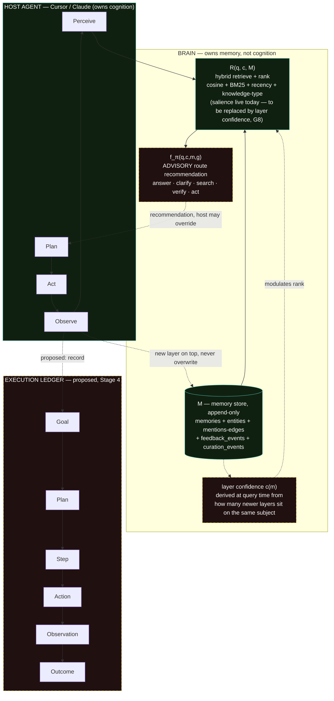
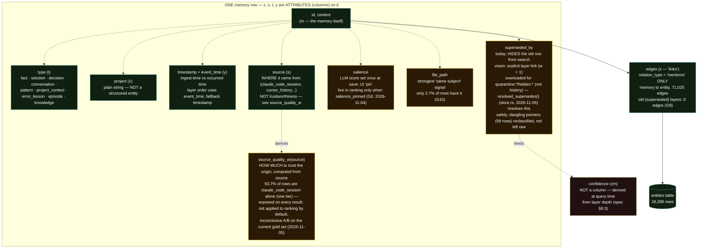
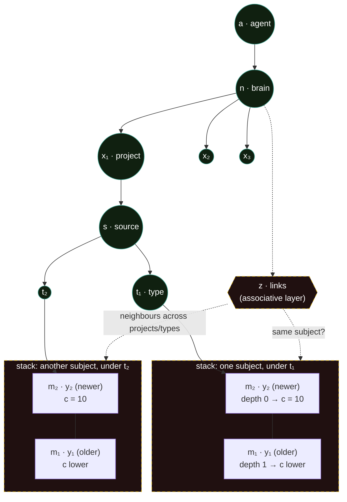
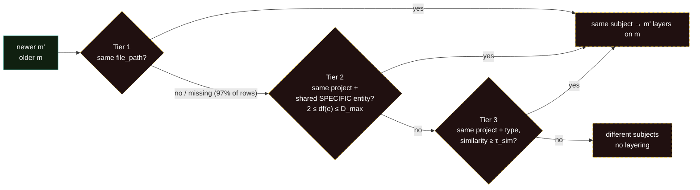

# Cognitive Architecture — Vision Diagram

Companion to `docs/architecture/cognitive-architecture-spec.md`. Three views: the full loop at scale, a zoom into the memory row mapped against the original vision, and the owner's temporal-layer model (spec §8).

Sources: the original vision (`docs/architecture/I designed this for brain, what do u think_.md`) and the owner's hand-drawn sketches from 2026-10-21 (`docs/architecture/sketches/2026-10-21-layers-full.png`, `docs/architecture/sketches/2026-10-21-layers-zoom.png`).

Solid/green = exists in code today. Dashed/yellow = proposed, not built. Red = referenced in the vision but doesn't exist in that form yet.

**Revised 2026-10-21:** confidence is now defined (layer confidence, derived at query time, spec §8.3), salience is marked for retirement from ranking, `superseded_by` is reinterpreted as a layer link, and §3–§4 are new.

**Revised 2026-11-05:** salience retirement shipped as `salience_pinned` (G0) rather than a blind retirement — see section 2's `SAL` node. `source_quality_w` added as a new, real (code-shipped) node, closing the gap where the original vision's `source_quality` idea had no place in this diagram — see section 2's new `SQ` node and item 4 below.

---

## 1. Full architecture in vision



**Reading it:** Brain is one box, not the whole diagram. Perceive/Plan/Act/Observe belong to the host today and stay there in every stage of the spec. Brain's proposed expansions beyond "store and rank" are two advisory signals: **layer confidence** (which memory in a stack to trust) and **route identification** (what the host should do next). Both are recommendations the host can ignore, not replacements for the host's box.

---

## 2. Memory structure — mapped to the original vision's symbols

Verified against `brain/rust/src/types.rs` and the live schema:



### Where the vision matches, and where it doesn't

1. **Type / source / date / project as a tree above memory** — matches, as a **view**. In the owner's sketch they form a navigation path (`brain → project → source → type → date`). Those are all columns on one row, so the tree is a way of addressing and filtering existing data and needs no new tables. That path is the structured, traceable half of the hybrid system.

2. **`links` (z)** — exists, but narrower than drawn: "this memory mentions this entity" (e.g. a memory mentioning "Supabase" links to a `Supabase` entity row). It is not memory-to-memory reasoning ("this contradicts that"). That richer link type was tried once (`graph_expand`), measurably hurt retrieval, and is off by default pending a benchmark. In the owner's model, `z` is the associative half: it finds neighbours and decides which memories are layers of the same subject (§4 below).

3. **`confidence` (c)** — **now defined** (spec §8). It is not salience (the LLM's one-time score) and not the raw ranker `score`. It is **layer confidence**: how many newer memories sit on top of this one about the same subject. It is **computed at query time and never stored**, so old memories are never rewritten. On the sketch's 1–10 scale, the top layer is `c = 10`.

4. **`source_quality` (s, trustworthiness half)** — the original vision conversation proposed this, and the gate table carried it forward as an orphaned "G2" reference that the 2026-10-21 revision never reconciled against the layer model. It earns a real place here because it answers a question neither `salience_pinned` nor layer confidence does: not "did a human pin this" and not "has something newer superseded it," but "how much should I inherently trust the pipeline that produced it, independent of both." Implemented 2026-11-05 as `source_quality_w(source)` — a pure function of the already-stored `source` enum, no schema column needed. Exposed on every search result; **not** applied to `final_score` by default, matching the discipline G0 established for salience. A/B on the current gold set was inconclusive (97.8% of the corpus shares one tier, so nothing in that set exercises a real tier contrast) — needs a gold set that actually contrasts `obsidian_books`/`perplexity` against session capture before this can be validated either way.

---

## 3. Temporal layers — the owner's model (spec §8)

Append-only: a change adds a new layer on top, and the old layer stays, linked and traceable.



**Key rule:** confidence depends on **relative depth within a subject's stack, not absolute age.** A year-old decision that nothing has replaced stays `c = 10`. A file changed three times last week leaves its first version low. Absolute age is handled separately and lightly by `recency_w`.

```
depth(m)   = Σ  w(m, m')   over newer m' on the same subject   (w ∈ [0,1], 1 if explicit supersede)
layer_w(m) = F + (1 − F) · λ^depth(m)        ranking modulator, bounded [F, 1]
c(m)       = 1 + 9 · λ^depth(m)              display scale 1–10
```

---

## 4. Spotting specifics — how Brain decides two memories share a subject

From the sketch: *"For a vectorize layer we need a way to spot specifics, but this can be a wide range of things."*



| Tier | Live data (2026-10-21) | Problem to solve |
|---|---|---|
| 1 file path | 614 rows have one; 44 paths have >1 memory | Capture at save time + index (G10) |
| 2 specific entity | 28,289 entities: 18,747 used once (useless), 95 used 50+ times (too generic, e.g. Next.js 805), useful middle like `SmileDoc.tsx` (9) | Pick `D_max`; filter noise entities |
| 3 similarity | every row has an embedding | Precompute `similar_to` neighbours (G7) to keep it cheap |

**Ground truth for tuning:** 1,780 real "newer replaced older" pairs already in the DB (spec §8.6). Today 0 of their older rows have entity links, because entity backfill skips superseded rows (G9). The experiment in spec §8.7 measures each tier against these pairs before anything changes live.
