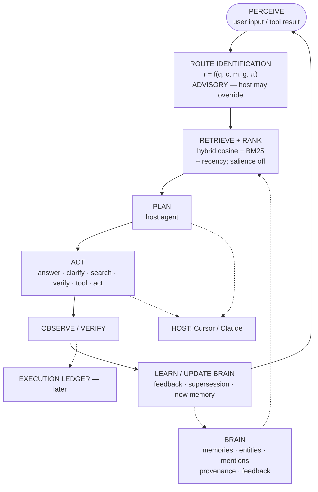

# Trustworthy Memory → Advisory Routing (Design)

**Date:** 2026-10-16  
**Status:** Proposed — awaiting approval before any schema or API changes  
**Identity (current):** Brain is a provenance-aware hybrid retrieval and memory-ranking system that observes an external host agent. It is **not** an executive brain.

## Problem

Several metadata fields look semantically richer than they are. Future routing or ranking must not treat them as decisions, derivation, or quality signals they are not. Prematurely building a cognitive router on top of misleading fields would encode the wrong contracts into production.

## Non-goals (this design)

- Full autonomous executive (goals/plans/actions as first-class cognition inside Brain)
- Turning `graph_expand` on by default
- Indiscriminate typed edges (`supports`, `contradicts`, `depends_on`) without eval
- Promoting advisory routing to authoritative control
- Online weight updates / LoRA / embedding retraining

## Verified current state (code + docs)

Grounded in `brain/rust/src/types.rs`, `brain/tools/confidence_score.py`, `docs/PHASE6_SALIENCE.md`, `docs/ENTITY_EDGE_GRAPH.md`, Phase 7 feedback plan.

| Concept in discussion | What exists today | Honest meaning |
| --- | --- | --- |
| `derived_from` | `MemoryMetadata.derived_from: Option<String>` | Extractor model + prompt version stamp (e.g. `ollama/.../v1`). **Not** parent-memory derivation. Code comment already says this; the **name** misleads. |
| Parent episode | `parent_id` | Fact → episode extraction parent. Closest thing to “derived from memory,” but episode-scoped. |
| Supersession | `superseded_by: Option<String>` + `exclude_superseded` (default true) | Pointer field on the row, not a normalized relation table. Curator UPDATE/MERGE sets it. |
| `outcome` | `fact_type` enum value in `fact_extractor.py` | Classification tag for extracted facts. **Not** an action/execution result. |
| `source` | `MemorySource` enum | Ingestion origin (Claude session, Obsidian, …). **Not** source quality. |
| `mentions` | Sole `edges.relation_type` default | Extraction link memory→entity. **Not** a semantic claim relation. |
| `salience` | Stored float; **β=0.0 in ranker** | Extractor confidence / UI audit field. Phase 6: **not** used in retrieval scoring (anti-correlated with curator ADD). |
| Corroboration confidence | `brain/tools/confidence_score.py` | Shadow-mode report only; does **not** persist or call `update_salience`. |
| `project` | `String` on every memory | Folder/cwd-derived label. Not a structured project entity. |
| Time fields | `timestamp`, `event_time` | `event_time` = when the fact/event occurred. `timestamp` is documented as ingest time but some ingest paths pass historical session times into it — **partial conflation**. There is no dedicated `observed_at` distinct from both. |
| Feedback | `feedback_events` + `record_feedback` / `POST /feedback` | Phase 7 Path A1: accepted/rejected/edited/ranked/dismissed. No host-route decision log. |
| Graph expand | Flag default **off** | Docs: no valid gold A/B PASS yet; live probe showed neighbor displacement. **Do not cite an unverified hit@10 delta.** Flip only when `graph_expand_ab.py` returns PASS. |
| Routing | Host (Cursor/Claude) informal | No `recommend_route` / disagreement telemetry. |

## Architectural boundary

```text
m = R(q, c, M)          # Brain: retrieve + rank
r = f(q, c, m, g, π)    # proposed: advisory route (later)
a = PlanAndAct(...)     # Host: plan + act
o = Observe(a)          # Host: observe
M' = U(M, ..., o)       # Brain: learn / feedback (thin today)
```

Host owns perceive / plan / act / observe. Brain owns retrieve / rank / provenance / curation / (weak) feedback. Route identification, when added, is **advisory** — host may override.

## Recommended stages

### Stage 1 — Semantic cleanup (trustworthy memory)

Define and document a memory contract before cognition:

```text
Memory {
  id, content, type, project,
  event_time,          # when the fact/event occurred (exists)
  observed_at,         # when Brain first encountered it (clarify vs timestamp)
  source,              # ingestion origin (exists)
  source_quality,      # NEW only with defined scale + write path
  salience,            # extractor confidence (exists; keep out of rank until calibrated)
  importance,          # exists
  confidence,          # NEW only if distinct from salience; persist only with interpretation
  supersedes / superseded_by,  # exists as field; optionally normalize later
  status               # NEW: active | uncertain | superseded | quarantined | disputed
}
```

**Highest-value Stage 1 moves (ordered):**

1. **Rename semantics of `derived_from` → `extracted_by`** (API alias + column rename or dual-read; reserve `derived_from_memory_id` for real parent-memory links).
2. **Clarify time contract:** document and, if needed, backfill `observed_at` vs `timestamp` vs `event_time` so recency/ranking cannot misread ingest time as event time.
3. **Do not persist corroboration confidence** until bands + demotion safety pass (existing shadow tool).
4. **Do not invent `source_quality` or `status` enums** until write paths and retrieval effects are specified.
5. **Keep `mentions`-only graph**; any new relation must earn lift on a gold set (hit@k, conflict detection, provenance quality, etc.).
6. **Projects stay strings** until a structured project entity has a clear query need (continuity / filter), not “ontology completeness.”

### Stage 2 — Observability at the host boundary

Extend (do not replace) Phase 7 feedback with **decision events**:

```json
{
  "session_id": "...",
  "request_id": "...",
  "recommended_route": "search",
  "selected_route": "answer_from_context",
  "retrieved_memory_ids": ["..."],
  "tool_calls": [],
  "user_correction": false,
  "result_quality": null
}
```

Primary early metric: **router–host disagreement**, not route accuracy in isolation. Classify: router wrong / host wrong / both reasonable / lacking context / retrieval insufficient / policy override / ambiguous.

Also: link curation events to affected memory IDs (partially exists via `curation_events`).

### Stage 3 — Advisory routing (thin)

```text
query → classify request → retrieve → expose route recommendation → host decides → record
```

Example advisory payload:

```json
{
  "intent": "retrieve_project_context",
  "risk": "low",
  "recommended_mode": "search",
  "memory_query": "current Brain architecture and route design",
  "confidence": 0.86,
  "requires_external_tool": false,
  "requires_confirmation": false
}
```

Promote toward enforcement only if utility ΔJ > 0 vs host-only baseline (correctness, faithfulness, usefulness, latency, cost, risk).

### Stage 4 — Execution ledger (later)

Store Goal → Plan → Step → Action → Observation → Outcome as an **execution ledger**, not as ordinary memories. Convert validated outcomes into durable memories. Do not mix unfinished plans with stable knowledge.

## Agent loop (distributed)



## Algebraic contracts (validation order)

1. **Retrieval first** — gold set; Precision@k / Recall@k / MRR / NDCG; ablations on cosine, BM25, recency, salience, priors.
2. **Ranker invariants** — monotonicity for source quality (once defined); stability under paraphrase; conflict signaling as a feature, not blind graph expand.
3. **Advisory route** — confusion matrix + macro-F1 + high-risk recall; then ΔJ vs host-only.
4. **Loop invariants** — provenance for claims; no action without capability; approval for high risk; only validated observations update durable M; termination / clarify / safe failure.
5. **Learning** — before/after R@k and regression rate on related queries.

## Relation to existing roadmap docs

| Existing doc | Relationship |
| --- | --- |
| `docs/plans/2026-04-07-possible-evolution-neural-memory-to-autonomy.md` | Path A1 feedback already started; this design keeps Path B autonomy **later** and inserts trustworthy-memory + advisory route before planner/executor. |
| `docs/plans/2026-04-07-phase-7-feedback-and-observability.md` | Stage 2 extends Phase 7 with route/decision events. |
| `docs/PHASE6_SALIENCE.md` | Confirms salience must stay out of scoring until recalibrated. |
| `docs/ENTITY_EDGE_GRAPH.md` | Confirms `mentions`-only + `graph_expand` off until PASS. |
| `docs/architecture/system-diagrams.md` | Companion diagrams for runtime/storage; agent-loop diagram lives here until folded in. |

## Decision gates (require human approval)

| Gate | Question |
| --- | --- |
| G1 | Approve Stage 1 field rename / time-contract clarification (breaking or dual-read)? |
| G2 | Approve adding `status` / `source_quality` columns, or defer until write paths exist? |
| G3 | Approve Stage 2 decision-event schema before any router code? |
| G4 | Any new edge type only after gold-eval PASS for a named metric? |

## Success definition for “done with Stage 1 docs+code”

- Field names and docs match behavior (no false derivation / quality / outcome semantics).
- Eval floors from Phase 6 / entity-graph docs unchanged on default search path.
- No router or executive ledger shipped under this stage.
